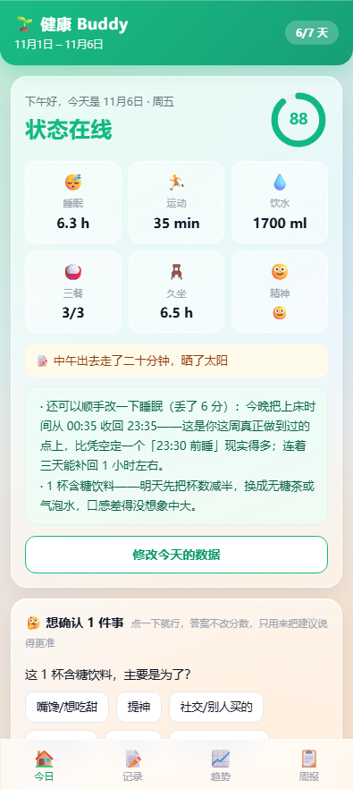
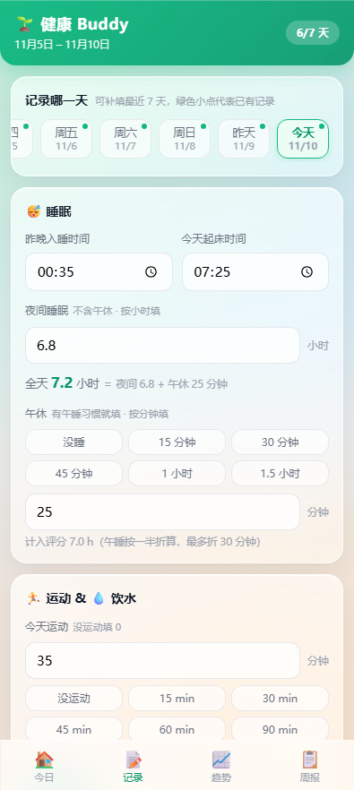
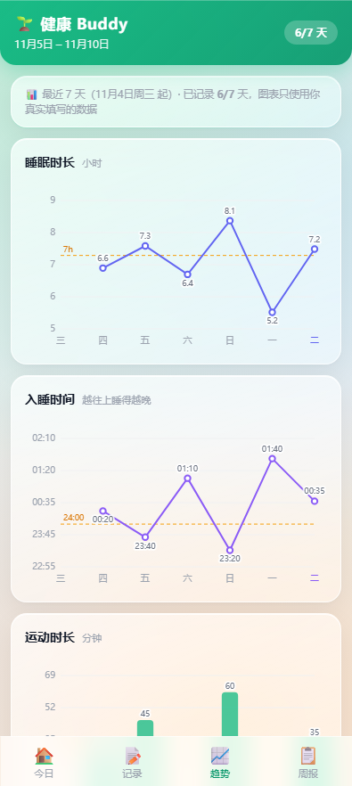
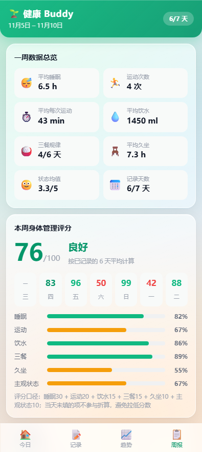
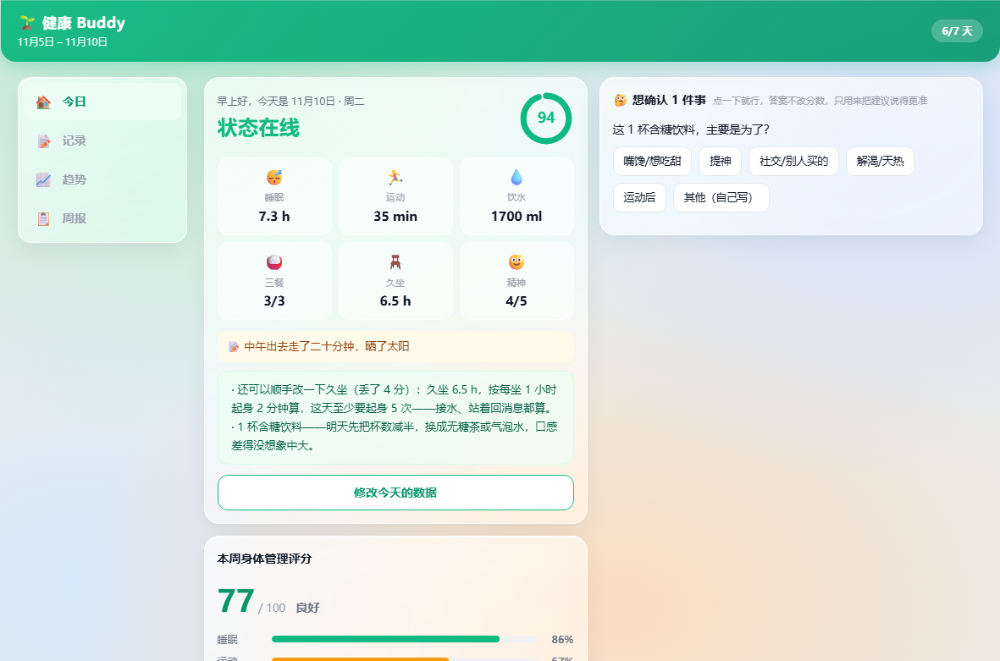

# 健康 Buddy · 7天身体管理工作台

一个只给自己用的身体管理工作台。每天用 30 秒记一笔，它负责算分、找原因、给建议。

**没有服务器、没有账号、没有埋点**，数据就在你本机：浏览器里存 localStorage，桌面版写本地 CSV，安卓版可导出 CSV。

<p align="center">
  
  
  
  
</p>
<p align="center"><sub>手机上：今日 / 记录 / 趋势 / 周报</sub></p>

<p align="center">
  
</p>
<p align="center"><sub>Windows 桌面版：左侧导航 + 双列布局，数据直接写桌面上的 CSV</sub></p>

---

## 和同类工具的区别

自托管的健康/习惯记录工具（wger、Baby Buddy、Endurain 等）通常要装 Docker、跑数据库、开个端口给别人访问。这个不用：

- **解压双击就能用**，不装 Node、不装数据库、不需要管理员权限
- **数据是一个 CSV 文件**，在桌面上，能用 Excel 打开、能手改、能拷走，删掉软件也不会丢
- **断网完全可用**，整个应用没有一行联网代码
- 代码量很小：页面是**一个 163 KB 的 HTML**，没有构建步骤、没有 npm 依赖、没有 CDN

---

## 直接下载（不用编译）

到 [**Releases**](../../releases/latest) 页面下载：

| 平台 | 文件 | 怎么用 |
|---|---|---|
| Windows 64 位 | `HealthBuddy-desktop-v1.2.16-win64.zip` | 解压后双击 `HealthBuddy.exe`。免安装、不写注册表，删掉文件夹即卸载 |
| 安卓 7.0+ | `HealthBuddy-android-v1.2.16.apk` | 传到手机安装；已装旧版可直接覆盖，数据不丢 |

> 首次运行 Windows 可能提示「已保护你的电脑」——程序没有购买代码签名证书，点「更多信息 → 仍要运行」。
> 若只想看看界面，也可以直接下载仓库里的 `健康Buddy-7天身体管理工作台.html`，双击用浏览器打开。

---

## 两种形态

| 形态 | 怎么用 | 技术 |
|---|---|---|
| 桌面版（Windows） | 解压后运行 `HealthBuddy.exe` | Electron |
| 安卓版 | 安装 `健康Buddy-安卓版-v1.2.16.apk` | Capacitor |

两端共用**同一份页面内核**（`健康Buddy-7天身体管理工作台.html`，单文件、零依赖），只是外壳不同。桌面版多了「读写本地 CSV」的能力，安卓版能把 CSV 导到手机的 `Documents/健康Buddy` 并调系统分享。

> 这个 HTML 是两端的共同来源，不作为独立形态发布——要改界面改它，然后同步到 `desktop-app/app/index.html` 并重新打包。

---

## 记什么

每天一条记录，19 个字段：

- **睡眠**：入睡时间、起床时间、夜间睡眠时长（按在床时间自动算，可微调）、午休分钟数
- **活动**：运动分钟、久坐小时
- **吃喝**：饮水量、三餐吃没吃、三餐吃了什么、含糖饮料杯数、主要食物类型
- **状态**：精神状态（1–5）、身体自评（1–5）、备注

**睡眠口径**：只有一个来源——「夜间睡眠」= 入睡到起床的在床时长（自动填入，躺很久才睡着的可以往下调）。午休单独记，程序算「全天睡眠 = 夜间 + 午休」。评分时午休只按 **50%** 折算、最多算 30 分钟，因为午觉补不回夜间深睡。

## 给什么

- **每日评分**：睡眠 30 / 饮食 20 / 运动 15 / 饮水 15 / 久坐 10 / 状态 10，折算百分制
- **建议引擎**：分成「证据 → 归因 → 处方」三层。先说数据里有什么，再说为什么，最后给出带剂量的建议（提前到几点睡、还差几杯水、起身几次）
- **备注校验**：备注里写的事实会和当天数据交叉核对，分成「数据印证 / 数据不支持 / 判不了」三种，自陈事实（生病、恢复期、生理期）单独归一类，不硬套
- **趋势**：一周的睡眠、运动、饮水、久坐曲线
- **周报**：按权重挑出最值得改的 4 件事，给可算的指标（睡眠债、社交时差、每周 150 分钟达标天数）

## 它会反问你

数据只能看出结果，看不出原因。同样睡 4 小时，加班和失眠要改的东西正好相反，所以页面会挑几件事反问你：

| 触发条件 | 它会问 |
|---|---|
| 睡了 8 小时但精神只有 2/5 | 今天是不是有剧烈运动、遇到大事、高强度用脑？ |
| 在床上躺了 2 小时才睡着 | 在想事情、刷手机、环境吵，还是身体不舒服？ |
| 含糖饮料 ≥ 1 杯且备注没写原因 | 这杯是嘴馋、提神、社交，还是解渴？ |
| 水没喝到 1000 ml | 忘了喝、不方便接水、不爱喝白水？ |
| 久坐 8 小时又没运动 | 没时间、太累、身体不舒服，还是忘了？ |
| 有一餐没吃 | 错过饭点、在控制体重、不饿？ |

回答全是点按钮，一天最多 3 条。**答案不参与打分**（分数要能跨周比较），只用来把建议说得更准；周报里还会汇总「同一件事这周出现了几次」。

## 情绪这件事

精神状态 ≤ 2 分时，先照顾人再谈数据：连续几天偏低就不再推数据建议，只留一件当天能做的小事。

备注里出现自伤或轻生的字眼时，页面会停下来——不显示分数、不给改进建议，只给出口：**全国心理援助热线 12356**（24 小时、免费、匿名），紧急情况 120 / 110。

这个工具不做心理评估，也不替代专业帮助。

## 输入校验

填错的数据比没填更糟，所以保存前会过一遍校验，分三档：

| 档位 | 例子 | 行为 |
|---|---|---|
| 必须改 | 睡眠 23 小时、运动 999 分钟 | 拦住，改完才能存 |
| 拦一次 | 入睡起床填反、在床时间比睡眠还短、三餐标没吃却写了吃了什么 | 第一次点只提示，第二次点才存 |
| 只提醒 | 睡眠不足 4 小时、饮水太少、躺很久才睡着 | 灰色提示，一次点击直接存 |

---

## 快速开始

**桌面版（Windows x64）**

```bash
cd desktop-app
npm install
npm start                 # 开发模式
```

打包成绿色版目录（不需要安装程序）：

```bash
./node_modules/.bin/electron-packager . HealthBuddy --platform=win32 --arch=x64 \
  --out=dist --overwrite --icon=build/icon.ico --prune=true --ignore="^/dist"
```

**安卓版**

需要 JDK 21（Capacitor 8 强制要求，17 不行）：

```bash
cd mobile-app
./build-release.sh        # 同步页面 → cap sync → assembleRelease → 复制 APK 到仓库根目录
```

签名用的 `healthbuddy.jks` 和 `keystore.properties` **不在仓库里**（见 `keystore.properties.example`）。自己打包要自备密钥；不备也能出 debug 包。

---

## 技术栈

| 层 | 技术 |
|---|---|
| 页面内核 | 原生 HTML / CSS / JavaScript，单文件约 163 KB、3080 行，零外部依赖，图表全是手写内联 SVG；桌面与安卓共用 |
| 桌面 | Electron 45 + @electron/packager 20，`contextIsolation` + `contextBridge`，CSV 读写走 4 个 IPC 通道 |
| 安卓 | Capacitor 8.6 + `@capacitor/filesystem` + `@capacitor/share`，Gradle 8.14.3、AGP 8.13、JDK 21，minSdk 24 / targetSdk 36 |

**为什么不用框架**：整个应用的目标是「一个文件、断网也能用、十年后还能打开」。引入构建链或 CDN 之后，任何一次外链失效都会让功能全废，而这个项目的全部价值就在「本地、可靠、不依赖任何服务」。

---

## 仓库结构

```
健康Buddy-7天身体管理工作台.html   页面源文件（唯一需要改的地方）
desktop-app/                       桌面版：main.js / preload.js / csv-store.js
  └ app/index.html                 页面副本，必须和根目录那份保持一致
mobile-app/                        安卓工程（只在 android 分支）
scripts/                           check-user-data.sh 查记录里的测试残留 / test-guard.js 防测试写库
rollback.sh                        版本回退脚本：列版本 / 打包 / 还原
健康Buddy-CSV数据模板.csv          空模板，19 列
健康Buddy-示例记录.csv             6 天示例数据（虚拟，非真实健康记录）
```

**分支模型**

- `main`：页面 + 桌面版。日常在这里改。
- `android`：安卓工程 `mobile-app/`。**永不在这个分支改页面**，需要新页面时 `git merge main`。
- 两条分支共用同一个页面文件，所以合并不会冲突。

---

## 数据与隐私

- 记录默认只存在本机，不上传任何服务器
- 桌面版直接读写你指定的 CSV 文件，可以自己用 Excel 打开看
- 页面默认零网络请求；只有在被宿主环境注入数据库 SDK 时才会启用在线同步，没有就自动回退本地存储
- 公开仓库里没有任何密钥、安装包、个人记录（见 `.gitignore`）

## 已知限制

- 桌面版只打了 Windows x64；Mac 需要自己用 `--platform=darwin --arch=arm64` 重新打
- 安卓版的 WebView 用系统自带的，版本太老的机器（Android 7–8）没有毛玻璃效果，滚动条可能仍会出现
- 没有多人协作、没有账号体系：换设备靠导出/导入 CSV 或 JSON

## License

MIT，见 [LICENSE](LICENSE)。

---

<sub>**English**: Health Buddy is a single-user, offline-first health tracking workbench. One self-contained HTML page (no framework, no build step, no CDN) ships as a Windows desktop app (Electron) and an Android app (Capacitor), both built on the same single-file page core. It logs 19 daily fields, scores the day across six weighted dimensions, and generates evidence-based suggestions and a weekly report. All data stays local — no backend, no account, no telemetry. MIT licensed.</sub>
